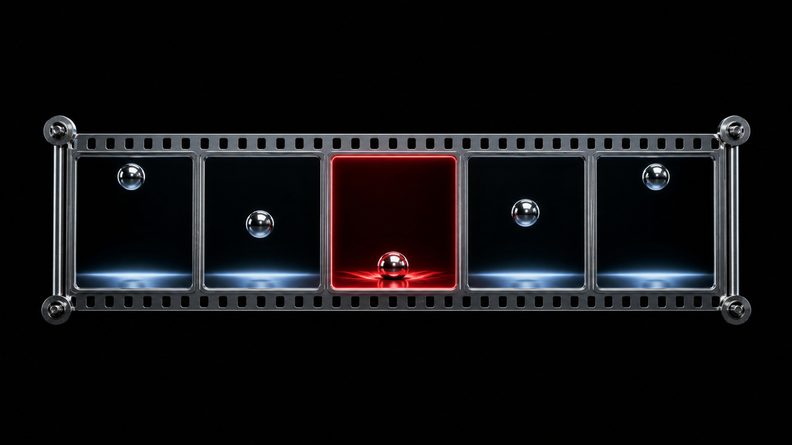
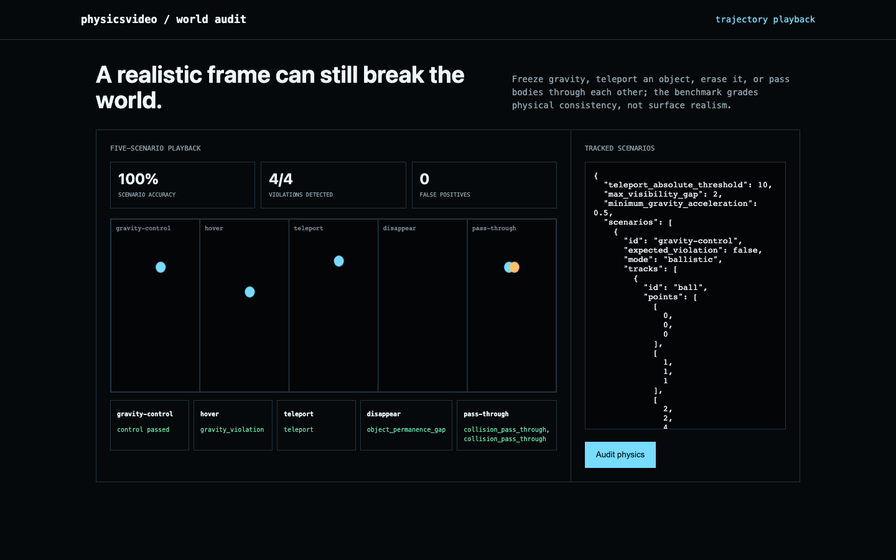

# physicsvideo

[](https://github.com/ahmeddoghri/physicsvideo/actions/workflows/tests.yml) [](https://adoghri.com/project-61.html)

**Physical-consistency benchmark for generated video.**

Audit tracked video trajectories for gravity, teleportation, object permanence, and collision response, then render the benchmark to MP4.





## What ships

- Five-scenario benchmark with one clean control and four targeted failures
- Gravity acceleration, teleport, visibility-gap, and declared-collision response checks
- Actual OpenCV MP4 renderer for the committed scenario suite
- CLI, JSON API, animated visual workbench, Docker, tests

## Run it end to end

```bash
python -m venv .venv && source .venv/bin/activate
python -m pip install -e .
physicsvideo demo
physicsvideo render scenarios.mp4
physicsvideo serve
```

## Demo result

The benchmark contains a valid falling-ball control plus hover, teleport, disappearance, and collision pass-through failures. The frozen checks detect all four violations with zero false positives: 5/5 scenario accuracy.

## Current basis

- [How Far Is Video Generation from World Model: A Physical Law Perspective, ICML 2025](https://proceedings.mlr.press/v267/kang25g.html)
- [PhyCoBench](https://arxiv.org/abs/2502.05503)

## Update: fixed a self-referential blind spot in teleport detection

The teleport check compared a track's largest frame-to-frame jump against a
threshold of `max(absolute_threshold, median(all steps in the track) * 6)`
-- but that median included the very jump being tested. For a track with
exactly one step (two tracked points), the threshold was necessarily at
least 6x that single step, so it could **never** exceed its own threshold,
no matter how large the jump.

Verified directly: an object tracked at only two points, teleporting 1000
units in a single frame, produced zero violations -- completely
undetected, despite being the most extreme case of the exact failure mode
this benchmark exists to catch.

Fixed with a leave-one-out threshold: each step's permissiveness threshold
is now derived only from the *other* steps in the track, never from
itself. `tests/test_two_point_teleport.py` covers the extreme two-point
case, a legitimate small two-point step (no false positive), a single
extreme jump mid-track, and a demo-output regression check; the published
demo numbers (4/4 violations detected, 0 false positives, 5/5 accuracy)
are unaffected.

## Rates, not five hand-built cases

Four of four on a curated fixture is an existence proof, not a rate.
`python -m physicsvideo.sweep` generates ballistic trajectories with
tracking noise, keeps half physically valid, and plants one fault in the
rest:

| | low noise (0.05) | high noise (0.4) |
| --- | ---: | ---: |
| false alarms on 100 clean clips | **0.0%** | **0.0%** |
| gravity violation detected | 100% | 100% |
| teleport detected | 100% | 100% |
| object-permanence gap detected | 100% | 100% |

Writing the generator surfaced a labelling trap worth naming: dropping
frames from the *end* of a track is an object leaving the scene, not a
permanence violation, and scoring it as one made the detector look 30%
worse than it is. The generator now only plants interior gaps.

## Scope

The checks operate on tracked trajectories. Appearance realism, deformable bodies, camera motion, occlusion semantics, and unobserved forces need richer task-specific evaluation.

## Test

```bash
python -m unittest discover -s tests -v
```

MIT licensed.
